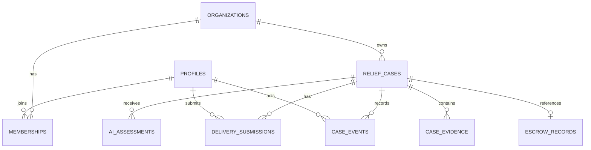

# Data Model and Supabase Access Rules

## 1. Data design principles

- Keep relational workflow data in Postgres.
- Keep evidence files in a private storage bucket.
- Store wallet public keys and opaque case hashes, not private keys or beneficiary identities.
- Use separate application and chain status fields.
- Use immutable audit rows for important human and system actions.
- Use synthetic seed data only for the hackathon.

## 2. Main entities

## 3. Tables (logical schema)

### `profiles`

- `id uuid primary key references auth.users(id)`
- `display_name text` (demo name only)
- `default_wallet_pubkey text null`
- `created_at timestamptz`

### `organizations`

- `id uuid primary key`
- `name text not null`
- `organization_type text check in ('ngo','supplier','donor_group','admin')`
- `demo_only boolean not null default true`
- `created_at timestamptz`

### `memberships`

- `id uuid primary key`
- `organization_id uuid references organizations(id)`
- `user_id uuid references profiles(id)`
- `role text check in ('field_worker','ngo_reviewer','supplier','donor','admin')`
- `wallet_pubkey text null`
- `created_at timestamptz`
- unique `(organization_id, user_id, role)`

### `relief_cases`

- `id uuid primary key` — internal random UUID
- `public_ref text unique not null` — human-readable non-identifying reference, e.g. `RM-DEMO-1042`
- `organization_id uuid references organizations(id)`
- `created_by uuid references profiles(id)`
- `category text check in ('food','water','shelter','medical','transport','other')`
- `description_redacted text not null`
- `locality_label text not null` — synthetic general locality only
- `household_count integer null check (household_count > 0)`
- `requested_items jsonb not null default '[]'`
- `requested_amount_base_units bigint not null check (requested_amount_base_units > 0)`
- `token_decimals smallint not null`
- `urgency_suggestion text null`
- `urgency_human_override text null`
- `application_status text not null`
- `ai_status text not null default 'pending'`
- `assigned_supplier_organization_id uuid null references organizations(id)`
- `supplier_wallet_pubkey text null`
- `case_ref_hash text unique not null` — 32-byte SHA-256 hex hash; not a PII hash
- `created_at timestamptz`
- `updated_at timestamptz`

### `ai_assessments`

- `id uuid primary key`
- `case_id uuid references relief_cases(id)`
- `agent_type text check in ('intake','duplicate','evidence')`
- `model_provider text`
- `model_version text`
- `input_fingerprint text` — hash of minimized input, not raw PII
- `output jsonb not null`
- `confidence numeric null check (confidence between 0 and 1)`
- `created_at timestamptz`

### `case_evidence`

- `id uuid primary key`
- `case_id uuid references relief_cases(id)`
- `uploaded_by uuid references profiles(id)`
- `storage_path text not null` — private bucket path
- `mime_type text not null`
- `file_size_bytes bigint not null`
- `sha256_hash text not null`
- `evidence_type text check in ('request_support','invoice','delivery_note','other')`
- `created_at timestamptz`

### `delivery_submissions`

- `id uuid primary key`
- `case_id uuid references relief_cases(id)`
- `supplier_user_id uuid references profiles(id)`
- `invoice_reference text null`
- `invoice_total_base_units bigint null`
- `line_items jsonb not null default '[]'`
- `evidence_hash text not null`
- `review_status text check in ('submitted','needs_correction','approved','rejected')`
- `reviewed_by uuid null references profiles(id)`
- `reviewed_at timestamptz null`
- `created_at timestamptz`

### `escrow_records`

- `id uuid primary key`
- `case_id uuid unique references relief_cases(id)`
- `network text not null check (network = 'devnet')`
- `program_id text not null`
- `escrow_pda text not null unique`
- `vault_token_account text not null`
- `token_mint text not null`
- `authority_wallet text not null`
- `supplier_wallet text not null`
- `donor_wallet text null`
- `target_amount_base_units bigint not null`
- `chain_status text not null check in ('created','funded','released','refunded','unknown')`
- `create_signature text null`
- `fund_signature text null`
- `release_signature text null`
- `refund_signature text null`
- `last_verified_at timestamptz null`
- `created_at timestamptz`

### `case_events`

- `id uuid primary key`
- `case_id uuid references relief_cases(id)`
- `actor_user_id uuid null references profiles(id)`
- `actor_role text not null` — snapshot of role at action time
- `event_type text not null`
- `event_payload_public jsonb not null default '{}'`
- `transaction_signature text null`
- `created_at timestamptz`

Do not store raw LLM prompts containing sensitive information in audit payloads.

### Additions in `0002_workflow.sql` (ADR-010, ADR-011, ADR-016)

- `relief_cases.approved_amount_base_units bigint null check (> 0)` — set by reviewer approval.
- `relief_cases.escrow_expires_at timestamptz null` — set by reviewer approval.
- `relief_cases.client_request_id uuid unique null` — `Idempotency-Key` of the creating request.
- `relief_cases.public_ref` defaults to `'RM-DEMO-' || nextval('relief_case_ref_seq')` (sequence starts at 1001).
- `relief_cases.updated_at` maintained by trigger.
- `case_events.internal_note text null` — private reviewer note; never returned by public endpoints.
- `transition_case(...)` — security-definer function, executable by `service_role` only: compare-and-set status update, optional allowlisted approval-field patch and audit-event insert in one transaction. Returns the event ID, or `null` when the current status is not the expected one.

## 4. Critical indexes and constraints

- Index `relief_cases (organization_id, application_status, created_at desc)`.
- Index `relief_cases (case_ref_hash)` unique.
- Index `ai_assessments (case_id, created_at desc)`.
- Index `case_events (case_id, created_at)`.
- Index `delivery_submissions (case_id, created_at desc)`.
- Use check constraints for positive token amounts and enumerated statuses.
- Use a transaction or database function for application-level status changes plus event insertion.

## 5. RLS policy requirements

RLS must be enabled on all tables containing user, case or evidence metadata.

- Profile: a user can read/update only their own limited profile fields.
- Membership: users can read memberships for organizations they belong to; only admin manages roles.
- Relief cases: field workers and NGO reviewers can access cases owned by their organization; donors can see only public-safe approved case summaries; suppliers can see cases assigned to their supplier organization.
- AI assessments: only members of the owning NGO organization and authorized admins can read; no public access.
- Evidence: access through authenticated API/signed URL with case-role check; storage bucket is private.
- Escrow records: authorized case members can read; public endpoints expose only safe chain data.
- Case events: authorized organization members can read internal events; public endpoint returns an allowlisted projection only.

The API must enforce role checks even when RLS is enabled. Do not expose the Supabase service-role key to the browser. Never rely on a client-provided organization ID or role without verifying membership.

## 6. Public-safe case projection

Expose only:

- `public_ref`
- broad category
- synthetic/general locality label
- requested total (if approved for public disclosure)
- application status
- funded/released amounts
- supplier organization display label (optional)
- transaction signatures and Devnet explorer links

Do not expose names, household identities, exact address, phone, medical data, original request text, uploaded files or private reviewer notes.

## 7. Token amount convention

All on-chain and database token amounts use integer base units (`bigint` in Postgres, `BN`/bigint in TypeScript). UI formatting uses mint decimals. Never perform amount calculations with binary floating point.
