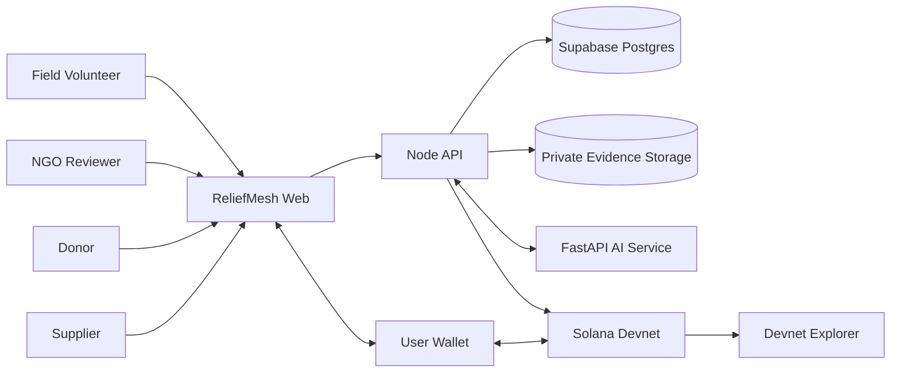
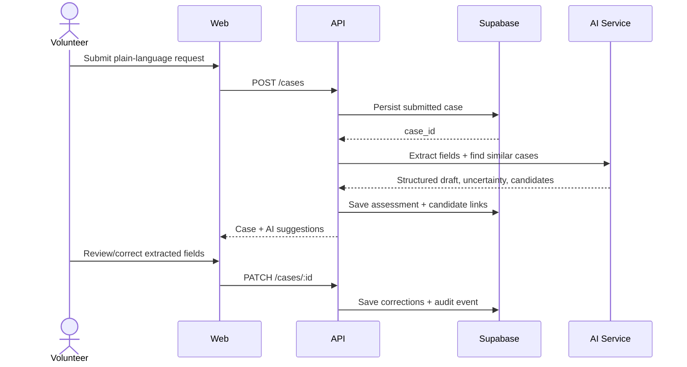
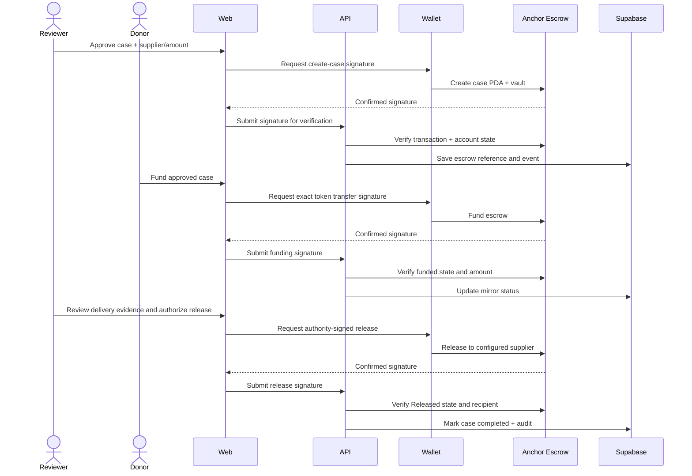

# System Architecture — ReliefMesh

## 1. Architecture summary

ReliefMesh uses a conventional web architecture with a dedicated AI service and a small Anchor escrow program.

- **React web app:** user experiences for field volunteer, NGO reviewer, donor, supplier and public-safe audit view.
- **Node API:** authentication, authorization, validation, workflow transitions, persistence and orchestration.
- **Python AI service:** structured extraction, duplicate candidate scoring and evidence field extraction. Advisory only.
- **Supabase:** application data, auth, private evidence storage and audit log.
- **Solana Anchor program:** case-specific token escrow and permissioned release/refund.
- **Connected wallet:** user-held signing authority. No server custody.

## 2. Context diagram

The API reads chain state and verifies signatures. A user wallet signs transactions initiated in the browser. The API must not possess the user's private key.

## 3. Component responsibilities

### Web app

- Role-aware navigation and forms.
- Wallet connection and transaction review.
- Shows the exact token, amount, supplier and network before a signing prompt.
- Displays AI suggestions as suggestions and marks human decisions separately.
- Verifies transaction confirmation and expected escrow account state before showing completed status.

### Node API

- Validates Supabase JWT and obtains user/organization/role context.
- Enforces organization-scoped authorization.
- Persists state transitions and immutable application audit entries.
- Calls AI service with minimal necessary data.
- Creates unsigned transaction instructions or verifies submitted signatures.
- Reconciles DB state with chain state; never trusts a client-provided `success: true`.

### Python AI service

- Stateless request/response service.
- Uses strict Pydantic models and structured provider output.
- Does not access Supabase with an unrestricted service-role key.
- Does not sign transactions, approve cases or change case state.
- Returns evidence references and confidence/uncertainty.

### Supabase

- Stores user profiles, organizations, cases, assessments, delivery submissions, funding metadata and application timeline.
- Stores uploaded evidence in private buckets.
- Applies RLS policies and server-side role checks.
- The DB is an application index and workflow record, not the source of truth for token settlement.

### Anchor program

- Derives a case PDA from an opaque case hash.
- Holds demo SPL tokens in a PDA-controlled token account.
- Enforces exact mint, amount, authority, supplier, status and expiry rules.
- Emits events containing only public-safe fields.

## 4. Trust boundaries

1. Browser input is untrusted.
2. LLM output is untrusted, even if it claims to be valid JSON.
3. Uploaded invoices/photos are untrusted files and may contain PII or malicious content.
4. The API database is not proof of on-chain settlement.
5. A submitted transaction signature is not proof of confirmation or expected state.
6. Wallet public keys are identifiers, not proof of a person's real-world identity.
7. AI similarity is not proof of duplicate fraud.

## 5. Core request flow

## 6. Funding and release sequence

## 7. State synchronization model

- Store `chain_status` and `application_status` separately.
- Keep `escrow_pda`, `vault_token_account`, `token_mint`, `authority_wallet`, `supplier_wallet`, `target_amount_base_units` and transaction signatures.
- Every signature has `submitted`, `confirmed`, `failed` or `expired` verification status.
- The API verifies via a Devnet RPC connection and reads the expected program account.
- Retry reconciliation jobs safely; do not apply duplicate status transitions.
- If DB update fails after a chain transaction confirms, a reconciliation endpoint/job must recover from the confirmed transaction and account state.

## 8. Failure handling

| Failure | Expected behavior |
|---|---|
| AI service down | Save case; mark AI status `unavailable`; manual review works |
| LLM malformed output | Reject output schema; retry once or use fallback; no state transition |
| Wallet rejected | Keep current state; show cancellation; no failed payment claim |
| RPC slow | Show `pending confirmation`; poll with timeout; allow refresh |
| Transaction fails | Surface program error; keep DB chain state unchanged |
| Duplicate webhook/retry | Idempotent reconciliation; do not double-release |
| File upload fails | Keep case form; allow retry; no fake evidence record |
| Unauthorized reviewer | API rejects; on-chain program also rejects wrong authority |

## 9. Deployment topology

- Web: Vercel or equivalent static hosting.
- API: one Node service.
- AI: one FastAPI service; can be co-located locally for demo.
- DB/storage/auth: Supabase project.
- Chain: Solana Devnet.
- All services share a single demo environment configuration and a visible `DEMO / DEVNET` banner.

## 10. Architecture choices deliberately avoided

- No microservice mesh, Kafka, Kubernetes or complex event bus.
- No agent swarm or autonomous on-chain transaction execution.
- No beneficiary wallet requirement.
- No personal data on-chain.
- No multi-chain support.
- No real payment gateway or production donation custody.
